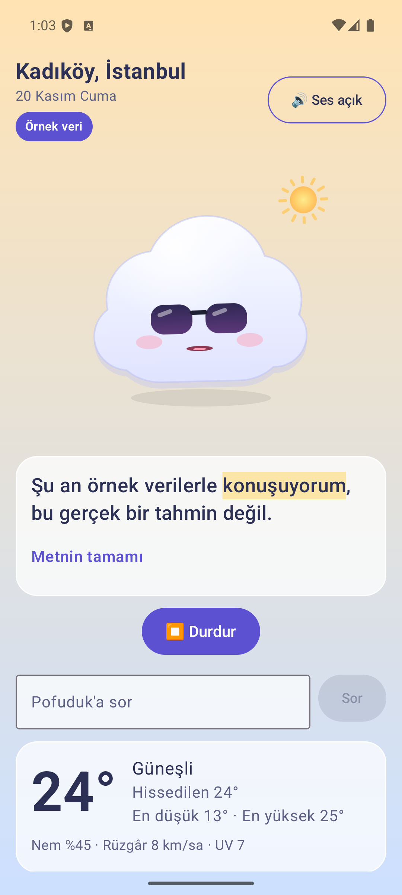

# Pofuduk (Android)

Türkçe konuşan, sevimli bulut karakterli hava durumu uygulamasının Android sürümü (Kotlin + Jetpack Compose).
iOS sürümü ayrı repodadır; iş mantığı (`core`) iOS `PofudukCore` paketinin birebir Kotlin portudur.

```
scripts\gradle.cmd :core:test            # iş mantığı testleri (JVM)
scripts\gradle.cmd :app:assembleDebug    # debug APK
```



Belgeler: `ARCHITECTURE.md`, `ROADMAP.md`, `PROJECT_STATUS.md`, `API_INTEGRATIONS.md`, `PRIVACY.md`.
